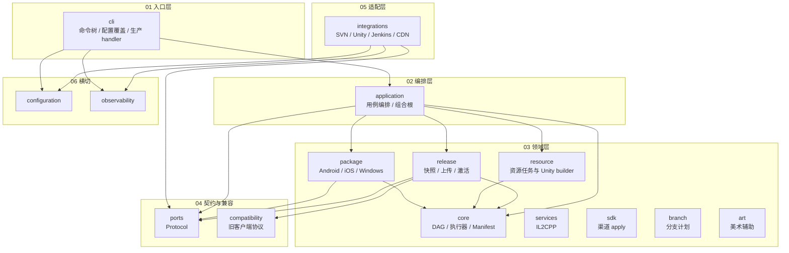
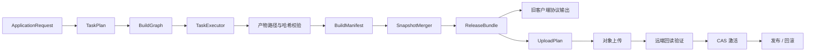

# 构建系统架构可视化

本目录保存构建系统的可视化架构说明。图形根据当前工作区的包间导入关系和代码规模生成，
统计快照为 2026-10-25；代码变化后需要重新生成。

- `build-system-framework.html`：自包含交互页面，浏览器直接打开即可，不依赖网络。
- `build-system-framework.fragment.html`：交互页面源文件，供 Codex 可视化渲染器重新生成独立 HTML。

页面包含三个视图：分层视图展示 16 个顶级包的层级与包级依赖；流水线视图展示从
`ApplicationRequest` 到 `BuildManifest`、`ReleaseBundle`、旧协议输出、上传验证和 CAS 激活的链路；
模块视图列出各包的文件数、代码行数、测试数与接入状态。

## 状态含义

- **已接入**：可以从 CLI 或 application 组合根触达，并有自动化测试覆盖。
- **部分接入**：本地代码可用，但真实工具链、部分命令或组合装配尚未闭环。
- **仅库可用**：代码与测试存在，尚未注册 CLI 命令或接入生产组合根。

真实环境验收仍未关闭：Unity 实机资源规则、SVN/Jenkins/Secrets/CDN 探针、
Android/iOS/Windows 工具链、IL2CPP/SDK 执行、branch 写操作、art 实工具以及旧客户端 Parser
均保持 `PENDING`。图中只描述本地接入状态，不能作为生产可用证据。

## 待收敛的依赖方向

当前导入扫描发现两处与设计文档依赖方向不一致的关系：

- `application` → `cli`：`src/application/preflight.py` 直接导入 `cli.config.BuildConfig`，
  而设计文档规定方向为 `cli → application`。
- `release` → `compatibility`：`src/release/protocol_outputs.py` 直接调用兼容协议 writer，
  与“领域层不导入兼容层”的约束冲突。

## 分层概览

红色越层依赖对应 `application → cli` 与 `release → compatibility`，见上一节。

## 构建与发布链路

构建与发布分离：同一份 `BuildManifest` 可以生成多个 `ReleaseBundle`，无需重复运行 Unity。

## 数据来源

- 包间依赖：扫描 `src/<package>/**/*.py` 的 `from` / `import` 语句，统计顶级包之间的导入处数。
- 规模：各包 Python 文件数与物理行数。
- 测试基线：2026-10-25 运行 `python -m pytest -q`，结果为 `916 passed, 4 skipped`；
  4 个跳过项来自当前 Windows 环境的符号链接权限与大小写不敏感文件系统限制。
